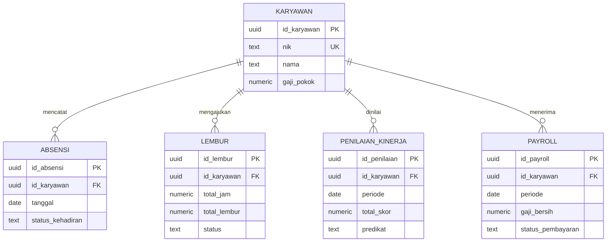

# MedHR

**Hospital Human Resource & Payroll Management System** mengintegrasikan data karyawan, absensi, lembur, penilaian kinerja, payroll, slip gaji, dan laporan biaya tenaga kerja. Aplikasi dibuat sebagai contoh Sistem Informasi Akuntansi untuk operasional rumah sakit.

## Teknologi

- Frontend: HTML, CSS, JavaScript vanilla, Chart.js, Lucide icons.
- Database: Supabase PostgreSQL dengan Row Level Security, constraint, index, function, dan trigger.
- `backend/app.js`: server file statis opsional menggunakan modul bawaan Node.js. Data aplikasi tetap dibaca/ditulis langsung ke Supabase dari frontend.
- Tidak menggunakan package manager, `package.json`, `.env`, atau `localStorage` sebagai database.

## Struktur Folder

```text
.
├── .github/workflows/pages.yml
├── backend/
│   ├── app.js
│   └── supabase/schema.sql
├── frontend/
│   ├── index.html
│   ├── css/style.css
│   └── js/
│       ├── app.js
│       ├── karyawan.js
│       ├── absensi.js
│       ├── lembur.js
│       ├── kinerja.js
│       └── payroll.js
└── README.md
```

## ERD: Lima Entitas Inti



Lima tabel inti adalah `karyawan`, `absensi`, `lembur`, `penilaian_kinerja`, dan `payroll`. Foreign key anak mengarah ke `karyawan.id_karyawan` dengan `ON DELETE CASCADE`. Absensi unik per karyawan/tanggal; kinerja dan payroll unik per karyawan/periode.

## Menyiapkan Supabase

1. Buat project PostgreSQL baru di [Supabase](https://supabase.com/) dan catat password database untuk kebutuhan pengelolaan project saja. Aplikasi ini tidak memakai password tersebut.
2. Buka **SQL Editor** pada project.
3. Buka `backend/supabase/schema.sql`, salin seluruh isinya ke query baru, lalu jalankan. Skema membuat lima tabel, index, trigger, RLS, policy demo, serta data awal untuk bulan berjalan. Skrip dapat dijalankan ulang.
4. Di dashboard project, buka **Project Settings → API** (atau **API Keys** pada dashboard baru). Salin **Project URL** dan public **anon/publishable key**.
5. Buka `frontend/js/app.js`, ganti nilai `SUPABASE_URL` dan `SUPABASE_ANON_KEY` dengan nilai public tadi. Jangan pernah memasukkan `service_role`/secret key ke frontend atau GitHub.
6. Reload aplikasi. Banner koneksi hilang setelah konfigurasi Supabase tersedia. Semua angka dashboard dan tabel dibaca dari database.

> **Keamanan akademik:** policy anon pada skema memberi akses baca/tulis luas dan sengaja disediakan hanya untuk demo/tugas lokal. Jangan gunakan policy ini untuk data rumah sakit atau data pribadi nyata. Untuk produksi, hapus policy demo, buat autentikasi, batasi akses per peran, serta lakukan audit keamanan.

### Logika database

- Absensi menghitung keterlambatan dalam menit terhadap jam kerja 08.00.
- Lembur menghitung durasi (mendukung pergantian tengah malam) dan nominal dari durasi × tarif.
- Penilaian menghitung rata-rata empat skor serta predikat.
- Payroll mengambil gaji pokok terbaru dari karyawan, menjumlah lembur berstatus `Disetujui` pada bulan yang sama, lalu menghitung gaji kotor dan bersih. Perubahan/approval lembur memperbarui payroll periode terkait.
- PostgreSQL memvalidasi unique key, rentang skor, status, nominal nonnegatif, NIK, dan format email.

## Menjalankan Aplikasi

**VS Code Live Server (disarankan)**

1. Buka folder project ini di VS Code.
2. Pasang ekstensi Live Server bila belum tersedia.
3. Klik kanan `frontend/index.html`, pilih **Open with Live Server**.

Alternatif dengan Node.js (tanpa install package):

```powershell
node backend/app.js
```

Lalu buka `http://127.0.0.1:8080`. `backend/app.js` hanya menyajikan berkas frontend; Supabase menjadi backend data.

## Deploy ke GitHub Pages

1. Push repository ke GitHub. Pastikan Supabase URL dan anon/publishable key sudah diatur di `frontend/js/app.js`; keduanya memang public browser credentials, tetapi RLS tetap wajib.
2. Pada repository buka **Settings → Pages → Build and deployment → Source**, pilih **GitHub Actions**.
3. Workflow `.github/workflows/pages.yml` akan deploy isi folder `frontend/` pada push ke branch `main` atau melalui **Actions → Deploy MedHR to GitHub Pages → Run workflow**.
4. Tunggu workflow selesai, lalu buka URL Pages yang ditampilkan GitHub.
5. Pastikan policy anon Supabase masih sesuai kebutuhan demo dan batasi domain/API settings bila diperlukan.

## Fitur dan Perhitungan

- CRUD karyawan, absensi, lembur, penilaian, dan payroll langsung ke Supabase, dengan modal, konfirmasi hapus, pencarian, dan filter.
- Dashboard menampilkan karyawan aktif, hadir hari ini, lembur menunggu, payroll berjalan, dan rata-rata penilaian, plus grafik dari query database.
- Persetujuan lembur memperbarui nominal lembur periode payroll.
- Payroll mengambil gaji pokok dan lembur disetujui; komponen hitung otomatis berada di PostgreSQL.
- Slip gaji dapat dilihat dan dicetak. Laporan menyediakan filter periode, ringkasan biaya pokok/tunjangan/insentif/lembur/potongan/gaji bersih, cetak, dan ekspor CSV.
- Jika project Supabase kosong, tabel menampilkan empty state. Jalankan data demo dari `schema.sql` untuk mencoba alur pertama.

## Troubleshooting

- **Banner Supabase masih muncul:** pastikan URL dan public anon/publishable key di `frontend/js/app.js` tidak lagi berisi `YOUR_`, lalu reload.
- **`Failed to fetch` atau CORS:** pastikan project aktif, URL benar, jaringan mengizinkan domain Supabase, serta jalankan melalui Live Server/HTTP server, bukan `file://`.
- **`relation does not exist`:** jalankan seluruh `backend/supabase/schema.sql` pada project Supabase yang benar.
- **RLS/policy error:** pastikan seluruh skrip berhasil dan policy academic demo terpasang pada kelima tabel. Jangan mengganti anon key dengan service-role key.
- **NIK/periode/absensi duplikat:** constraint menolak NIK yang sama, dua absensi karyawan pada tanggal yang sama, serta penilaian/payroll duplikat per periode.
- **Payroll lembur belum berubah:** hanya lembur berstatus `Disetujui` dalam bulan payroll yang dijumlahkan; refresh data setelah menyetujui pengajuan.
- **Chart kosong:** grafik mengikuti ketersediaan data pada periode saat ini. Tambahkan/seed data dan pastikan tabel dapat dibaca oleh anon policy demo.
- **`node` tidak dikenali:** gunakan Live Server atau pasang Node.js untuk server statis opsional.
